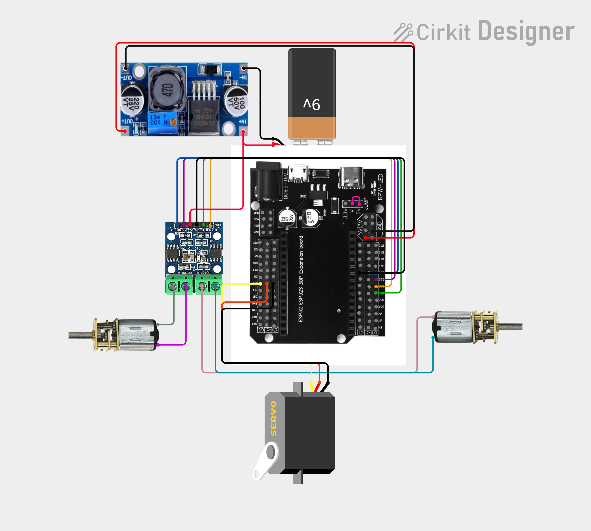
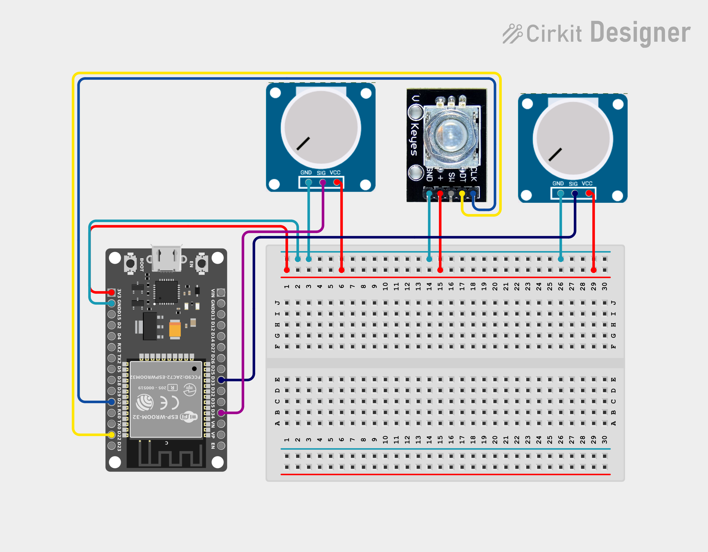

# SC-RC

A DIY RC car built around a custom steering wheel and pedal setup.

The idea is to make driving the car feel a little closer to driving an actual car. An ESP32 in the controller sends steering, throttle, and brake inputs wirelessly to another ESP32 on the car. A servo handles the front steering, while two N30 motors drive the rear wheels.

The chassis is 3D-printed and based on an existing design that I've modified for this build.

**Status:** Still a work in progress. The main parts are coming together, but there's more testing, calibration, and tuning to do.

## Hardware

- 2 × ESP32 boards — one for the controller and one for the car
- 2 × N30 DC motors for rear-wheel drive
- L9110 motor driver
- Servo motor for front steering
- Rotary encoder for steering input
- 2 × potentiometers for throttle and brake
- Custom 3D-printed steering wheel and pedal assembly
- 3D-printed car chassis

## Circuit diagrams

### Car

### Transmitter

